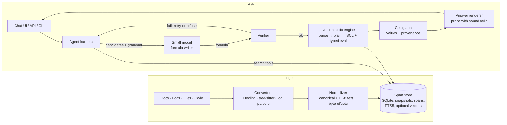

# spanql

**Ask questions of your documents, logs, files and codebases. Get answers you can audit like a spreadsheet.**

> **Status: early implementation (v0.1.0, pre-release).** Ingestion, the formula engine, the verifier, the model harness, CLI, HTTP API/UI, MCP server, Docker and a Homebrew formula work end to end. The model bake-off (M4) and fine-tune (M7) haven't happened yet, and interfaces may still change. See [docs/ROADMAP.md](docs/ROADMAP.md) and [ADR-0007](docs/adr/0007-implementation-deviations.md) for where the code differs from the design.

---

## The idea

Most "chat with your docs" tools let a language model read some retrieved text and then write an answer in prose. The answer *sounds* grounded, but the numbers, dates and names in it are whatever the model produced. You can't easily tell which ones were copied, which were computed, and which were made up.

spanql splits that job in two:

1. **A small local model writes a short formula, not an answer.** The formula points at the exact words in your sources (byte-precise *spans*) and says what to do with them: extract a number, count matching log lines, compare two dates, sum a column.
2. **A separate deterministic engine evaluates the formula.** Arithmetic, counting, date math and filtering are done by code, not by the model.
3. **Every value is a cell.** Like a spreadsheet, you can click any value in the answer and see its formula and the exact source text it came from (file, line, byte offsets, snapshot hash).
4. **If the answer isn't there, it says so.** A verifier rejects any formula that references text that doesn't exist, or that doesn't type-check. If no valid formula can be built from your sources, spanql answers "not found in your sources" and shows what it searched.

You talk to it like a chat bot. Under the hood it's closer to SQL: a question becomes a query plan over a span-addressable knowledge base.

```text
you>  How many payment timeouts did we log last Tuesday, and what % of all errors is that?

spanql>  There were [41] payment timeouts out of [312] errors on Tue Nov 10, which is [13.1%].

   [41]    = COUNT(FIND(src:"logs/payments-*.log", re:"ERROR .*PaymentTimeout", day:"2026-11-10"))
             → 41 matching lines · first: logs/payments-2026-11-10.log:L1043 · sha256:9f2c…
   [312]   = COUNT(FIND(src:"logs/payments-*.log", re:"\\bERROR\\b", day:"2026-11-10"))
   [13.1%] = PCT([41], [312], places:1)
```

```text
you>  What was our Q3 churn rate?

spanql>  I couldn't find this in your sources. I searched 3 quarterly reports and the
         metrics wiki for "churn", "retention" and "cancellations"; the Q3 report lists
         customer counts but no churn figure, and I won't compute one from a definition
         that isn't in your documents.
```

## Quickstart (from source)

Needs Python 3.12+ and [uv](https://docs.astral.sh/uv/). These are the exact commands used to check this README:

```sh
git clone https://github.com/johnnyclem/spanql && cd spanql
uv sync --all-extras            # app + tree-sitter grammars + pypdf + dev tools
uv run spanql selftest --no-model

# ingest the demo corpus (reports, a log file, a CSV, a small repo)
uv run spanql ingest examples/demo

# no model needed: the offline "fake" backend is a rule-based formula writer for demos/tests
uv run spanql --backend fake ask "How many PaymentTimeout errors were logged on 2026-11-10?"
#   2 matching log records.
#     [1] 2  = COUNT(FIND(kind:"log", re:"PaymentTimeout", day:"2026-11-10"))   (c_majbxalntk)
uv run spanql --backend fake ask "What was our Q3 churn rate?"
#   I couldn't find this in your sources. I searched 40 passages in 7 sources for "Q3", "churn", "rate". ...
uv run spanql trace c_majbxalntk          # formula, steps, inputs of a cell

# write formulas yourself; the engine evaluates them, no model involved
uv run spanql search "invoice West" -k 2
uv run spanql evaluate 'ANSWER(SUM(COLUMN(src:"demo/data/invoices.csv", "amount", FIELD("region") == "West")), text:"West invoices total {0}.")'
#   West invoices total 2,075.75.
```

Data goes to `~/.local/share/spanql` (override with `SPANQL_HOME` or `--db`). `spanql init` writes a config file with `[[sources]]` to ingest.

### With a real model (llama.cpp)

```sh
uv run spanql model pull qwen3.5-4b-instruct-q4_k_m        # 2.74 GB, pinned revision + sha256 (*)
llama-server -m ~/.local/share/spanql/models/qwen3.5-4b-instruct-q4_k_m.gguf \
  --host 127.0.0.1 --port 7718 -c 8192 --jinja
uv run spanql ask "How much did revenue grow from Q2 to Q3?"
#   Revenue grew by $510,000 (11.8%).
```

(*) The pull code path (resume, checksum) is tested against a mock server. For the live runs the same GGUF was downloaded directly and its sha256 matched the manifest. The `llama-server` and `ask` lines were run as shown (llama.cpp b12528, CPU).

The default backend is llama.cpp at `http://127.0.0.1:7718/v1`, with a per-request GBNF grammar so the model can only cite retrieved spans. With `model.runtime = "managed"` (written by `init` when `llama-server` is on PATH), `spanql serve` starts and supervises `llama-server` itself. Ollama (`--backend ollama`) and OpenAI-compatible servers (`--backend openai-compatible`) are supported too, but have only been tested against mocks. Informal results with Qwen3.5-0.8B and -4B are in [eval/SMOKE.md](eval/SMOKE.md).

### Chat UI, HTTP API, MCP

```sh
uv run spanql serve                   # http://127.0.0.1:7717 (web UI with clickable cells)
curl -s localhost:7717/v1/ask -H 'content-type: application/json' \
  -d '{"question":"When was the Q3 report published?"}'
# OpenAI-compatible: POST /v1/chat/completions with model "spanql"
uv run spanql mcp                     # MCP server on stdio: ask, search, evaluate, explain_cell, read_span, status
```

### Docker

```sh
mkdir -p sources && cp -r examples/demo sources/
docker compose run --rm pull          # downloads the model into the `models` volume
docker compose up -d                  # app + ghcr.io/ggml-org/llama.cpp:server sidecar
open http://127.0.0.1:7717
```

`compose.gpu.yaml` switches the sidecar to `server-cuda`. The image was built and run locally (selftest, ingest, grounded answers against a llama.cpp server, and the llama.cpp sidecar image with the compose flags). `docker compose` itself wasn't run, because the build box has no bridge networking.

### Homebrew (macOS)

`packaging/homebrew/spanql.rb` is the formula for a future `johnnyclem/homebrew-spanql` tap. It's HEAD-only until there's a release tag, and it includes a `service` block for `brew services start spanql`. On Linuxbrew it was checked with `brew style`, `brew install --HEAD` from a local tap, the post-install config, `brew test` and the service's `serve` command, including the managed `llama-server` from the `llama.cpp` formula. It hasn't been run on macOS or under launchd yet. See [docs/DEPLOYMENT.md](docs/DEPLOYMENT.md).

### Development

```sh
uv run pytest                         # offline; live model tests: SPANQL_LIVE_ENDPOINT=http://127.0.0.1:7718/v1 uv run pytest -m live
uv run ruff check . && uv run ruff format --check . && uv run mypy
```

## Why it might work with a *small* model

The model's job is narrow: pick spans from a candidate list and compose a formula in a tiny language. It does not have to do arithmetic, remember facts, or write long prose. Decoding is grammar-constrained so the model *cannot* emit a malformed formula or reference a span that wasn't retrieved. That's a job a 2–4B-parameter model can plausibly do well off the shelf, and very well after a targeted fine-tune. See [docs/MODEL.md](docs/MODEL.md).

## Runs where you run it

- **Docker / Compose**: one image for the app, with a model-runtime sidecar (llama.cpp server, Ollama, or vLLM on GPU hosts).
- **Homebrew service on macOS**: `brew install` from a tap, then `brew services start spanql`; on Apple Silicon it can use an MLX or Metal llama.cpp backend.

Everything runs locally. No source text leaves the machine unless you point it at a remote model endpoint. See [docs/DEPLOYMENT.md](docs/DEPLOYMENT.md).

## Architecture at a glance



## Documentation

| Doc | What's in it |
| --- | --- |
| [docs/ARCHITECTURE.md](docs/ARCHITECTURE.md) | Ingestion and the span store, the formula language (grammar, span references, operators), compilation to a query plan, the evaluation engine, provenance/cell tracing, the verifier and refusal |
| [docs/MODEL.md](docs/MODEL.md) | Candidate models, selection criteria, off-the-shelf baseline, fine-tune plan (data generation, LoRA, eval), serving backends |
| [docs/HARNESS.md](docs/HARNESS.md) | Agent loop, tools, chat interface, HTTP API, CLI |
| [docs/DEPLOYMENT.md](docs/DEPLOYMENT.md) | Docker image and Compose, volumes, CPU/GPU, Homebrew formula and `brew services` (launchd), config, model download |
| [docs/ROADMAP.md](docs/ROADMAP.md) | Milestones and exit criteria |
| [docs/PRIOR_ART.md](docs/PRIOR_ART.md) | Related research and tools, and what spanql borrows or does differently |
| [docs/adr/](docs/adr/) | Architecture decision records, incl. [0007: implementation deviations](docs/adr/0007-implementation-deviations.md) |

## Non-goals (for now)

- Open-ended summarization or "write me an essay about X". spanql answers questions whose answers are *in* or *computable from* your text.
- Being a general vector-search RAG framework.
- Multi-tenant hosted SaaS. This is a local, single-user (or small-team) service first.

## License

Not chosen yet. This is a decision for John before the first release. Until then, no license is granted. Model weights carry their own licenses (the Qwen3.5 GGUFs in the manifest are Apache-2.0); see [docs/MODEL.md](docs/MODEL.md).
