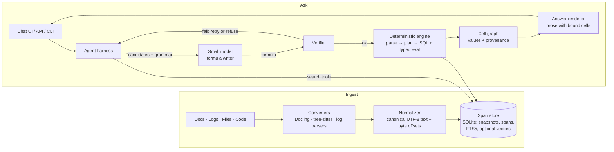

# spanql

**Ask questions of your documents, logs, files and codebases. Get answers you can audit like a spreadsheet.**

> **Status: design phase.** This repository contains design documents only. There is no implementation yet, nothing to install, and every interface described here may change. See [docs/ROADMAP.md](docs/ROADMAP.md).

---

## The idea

Most "chat with your docs" tools let a language model read some retrieved text and then write an answer in prose. The answer *sounds* grounded, but the numbers, dates and names in it are whatever the model produced. You can't easily tell which ones were copied, which were computed, and which were made up.

spanql splits that job in two:

1. **A small local model writes a short formula, not an answer.** The formula points at the exact words in your sources (byte-precise *spans*) and says what to do with them: extract a number, count matching log lines, compare two dates, sum a column.
2. **A separate deterministic engine evaluates the formula.** Arithmetic, counting, date math and filtering are done by code, not by the model.
3. **Every value is a cell.** Like a spreadsheet, you can click any value in the answer and see its formula and the exact source text it came from (file, line, byte offsets, snapshot hash).
4. **If the answer isn't there, it says so.** A verifier rejects any formula that references text that doesn't exist, or that doesn't type-check. If no valid formula can be built from your sources, spanql answers "not found in your sources" and shows what it searched.

You talk to it like a chat bot. Under the hood it's closer to SQL: a question becomes a query plan over a span-addressable knowledge base.

```text
you>  How many payment timeouts did we log last Tuesday, and what % of all errors is that?

spanql>  There were [41] payment timeouts out of [312] errors on Tue Nov 10, which is [13.1%].

   [41]    = COUNT(FIND(src:"logs/payments-*.log", re:"ERROR .*PaymentTimeout", day:"2026-11-10"))
             → 41 matching lines · first: logs/payments-2026-11-10.log:L1043 · sha256:9f2c…
   [312]   = COUNT(FIND(src:"logs/payments-*.log", re:"\\bERROR\\b", day:"2026-11-10"))
   [13.1%] = PCT([41], [312], places:1)
```

```text
you>  What was our Q3 churn rate?

spanql>  I couldn't find this in your sources. I searched 3 quarterly reports and the
         metrics wiki for "churn", "retention" and "cancellations"; the Q3 report lists
         customer counts but no churn figure, and I won't compute one from a definition
         that isn't in your documents.
```

## Why it might work with a *small* model

The model's job is narrow: pick spans from a candidate list and compose a formula in a tiny language. It does not have to do arithmetic, remember facts, or write long prose. Decoding is grammar-constrained so the model *cannot* emit a malformed formula or reference a span that wasn't retrieved. That's a job a 2–4B-parameter model can plausibly do well off the shelf, and very well after a targeted fine-tune. See [docs/MODEL.md](docs/MODEL.md).

## Runs where you run it

- **Docker / Compose**: one image for the app, with a model-runtime sidecar (llama.cpp server, Ollama, or vLLM on GPU hosts).
- **Homebrew service on macOS**: `brew install` from a tap, then `brew services start spanql`; on Apple Silicon it can use an MLX or Metal llama.cpp backend.

Everything runs locally. No source text leaves the machine unless you point it at a remote model endpoint. See [docs/DEPLOYMENT.md](docs/DEPLOYMENT.md).

## Architecture at a glance



## Documentation

| Doc | What's in it |
| --- | --- |
| [docs/ARCHITECTURE.md](docs/ARCHITECTURE.md) | Ingestion and the span store, the formula language (grammar, span references, operators), compilation to a query plan, the evaluation engine, provenance/cell tracing, the verifier and refusal |
| [docs/MODEL.md](docs/MODEL.md) | Candidate models, selection criteria, off-the-shelf baseline, fine-tune plan (data generation, LoRA, eval), serving backends |
| [docs/HARNESS.md](docs/HARNESS.md) | Agent loop, tools, chat interface, HTTP API, CLI |
| [docs/DEPLOYMENT.md](docs/DEPLOYMENT.md) | Docker image and Compose, volumes, CPU/GPU, Homebrew formula and `brew services` (launchd), config, model download |
| [docs/ROADMAP.md](docs/ROADMAP.md) | Milestones and exit criteria |
| [docs/PRIOR_ART.md](docs/PRIOR_ART.md) | Related research and tools, and what spanql borrows or does differently |
| [docs/adr/](docs/adr/) | Architecture decision records |

## Non-goals (for now)

- Open-ended summarization or "write me an essay about X". spanql answers questions whose answers are *in* or *computable from* your text.
- Being a general vector-search RAG framework.
- Multi-tenant hosted SaaS. This is a local, single-user (or small-team) service first.

## License

To be decided before the first code lands (see [ADR-0001](docs/adr/0001-record-architecture-decisions.md)). Model weights carry their own licenses; see [docs/MODEL.md](docs/MODEL.md).
