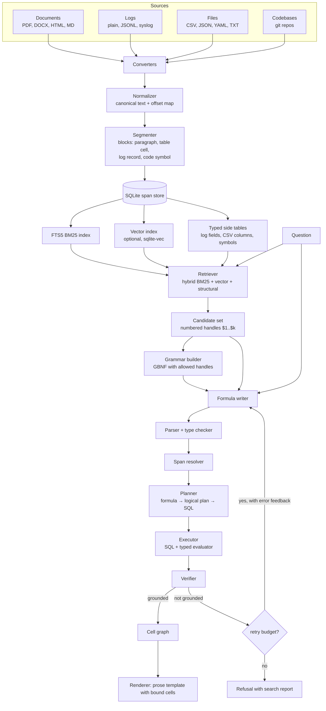

# Architecture

> **Implementation note (2026-11-19):** the first implementation differs from this document in a few places (snapshot ids, `match:` keyword, comparisons in the grammar, `[n]` references, strict V4, regex timeouts, Starlette/argparse, runtime defaults, Docker/Homebrew details). See [ADR-0007](adr/0007-implementation-deviations.md).

> Design phase. Nothing here is implemented. Names, schemas and grammar are proposals.

spanql has three cooperating parts with a hard boundary between them:

| Part | Is it a model? | Responsibility |
| --- | --- | --- |
| **Span store** | No | Turns sources into immutable, byte-addressable text snapshots and indexes them. |
| **Formula writer** | Yes (small LLM) | Reads a question plus *candidate spans* and emits one formula in the spanql formula language. Never emits final values. |
| **Engine + verifier** | No | Parses, type-checks, resolves and evaluates the formula deterministically, records provenance, and decides whether the result is grounded enough to show. |

The model is the only nondeterministic component, and it is boxed in on both sides: its *inputs* are retrieved by code, and its *outputs* are constrained by a grammar and then checked by code.



---

## 1. Ingestion and the span store

### 1.1 Goals

- **Exact addressing.** Any substring of any ingested source can be named by `(snapshot, byte_start, byte_end)` and re-read byte-for-byte later.
- **Stability.** A span reference written today still resolves tomorrow to the same bytes, even if the file was edited since. (It resolves to the *old snapshot*, and the UI says the source has changed.)
- **Type awareness.** Logs, tables and code have structure that should be queryable directly (timestamps, levels, columns, symbols), not only through free text.

### 1.2 Pipeline

1. **Discover.** Walk configured roots (`sources:` in config). Respect `.gitignore` for repos and a `.spanqlignore`. For git repos, record `commit` and use `git ls-files`.
2. **Convert** to text by type:
   - Documents (PDF, DOCX, PPTX, HTML): [Docling](https://github.com/docling-project/docling), which produces a structured document (headings, paragraphs, tables with cells, page numbers). We keep Docling's page/bbox metadata so the UI can also highlight a PDF region, but the *canonical* address is always the text offset.
   - Markdown / plain text: as-is.
   - CSV / TSV / JSON / YAML: parsed into rows and cells *and* kept as text, so a cell can be cited both as `row 12, column "amount"` and as bytes.
   - Logs: line- or record-oriented. Pluggable parsers (regex profiles for common formats, JSONL, syslog). Extract `ts`, `level`, `logger`, `message` and free fields into a side table.
   - Code: [tree-sitter](https://tree-sitter.github.io/tree-sitter/) grammars to segment into symbols (module, class, function, method) with names, kinds, and line ranges. A symbol table supports questions like "how many handlers call `retry()`".
3. **Normalize.** Produce the *canonical text* of the snapshot: UTF-8, `\n` line endings, NFC. Keep an **offset map** from canonical offsets back to raw-file offsets (and to PDF page/bbox where available). Citations are shown in canonical text; the map lets the UI open the original file at the right place.
4. **Snapshot.** `snapshot_id = sha256(canonical_text)`. A source has many snapshots over time; only the newest is *current*. Old snapshots are kept (configurable retention) because cells may reference them.
5. **Segment** into *blocks* (paragraph, heading, table cell, list item, log record, code symbol). Blocks are the retrieval unit. They are also spans.
6. **Index.** SQLite [FTS5](https://www.sqlite.org/fts5.html) over blocks (BM25 ranking), optional embeddings in [sqlite-vec](https://github.com/asg017/sqlite-vec), and typed side tables.

### 1.3 Span identity

A span is `(snapshot_id, start, end)` with byte offsets into canonical text, half-open. Its printable ID:

```text
sp:9f2c1a7e:1043:1071        # snapshot prefix : start : end
```

Plus a stored `text_sha256` of the covered bytes. Resolution is always verified: if the bytes at the offsets don't hash to `text_sha256`, the span is invalid (corruption guard).

**Re-anchoring.** When a source changes, existing cells still resolve against their original snapshot. Optionally, a re-anchor job tries to find each referenced span in the new snapshot (exact match of span text with surrounding context, then fuzzy), so the UI can say "this value is unchanged in the current version" or "this source changed; recompute?". Re-anchoring never silently rewrites a cell.

### 1.4 Storage schema (sketch)

```sql
CREATE TABLE source   (id INTEGER PRIMARY KEY, uri TEXT UNIQUE, kind TEXT,  -- doc|log|file|code
                       root TEXT, current_snapshot TEXT);
CREATE TABLE snapshot (id TEXT PRIMARY KEY,                                   -- sha256 of canonical text
                       source_id INTEGER REFERENCES source, ingested_at TEXT,
                       raw_sha256 TEXT, git_commit TEXT, text BLOB, offset_map BLOB);
CREATE TABLE block    (id INTEGER PRIMARY KEY, snapshot_id TEXT REFERENCES snapshot,
                       kind TEXT, start INTEGER, end INTEGER, text_sha256 TEXT,
                       path TEXT,            -- heading path / table+row+col / symbol path
                       line_start INTEGER, line_end INTEGER, page INTEGER);
CREATE VIRTUAL TABLE block_fts USING fts5(text, content='', tokenize='unicode61');
-- typed side tables
CREATE TABLE log_record (block_id INTEGER PRIMARY KEY, ts TEXT, level TEXT, logger TEXT,
                         message_start INTEGER, message_end INTEGER, fields JSON);
CREATE TABLE table_cell (block_id INTEGER PRIMARY KEY, table_id INTEGER, row INTEGER,
                         col INTEGER, header TEXT);
CREATE TABLE code_symbol(block_id INTEGER PRIMARY KEY, lang TEXT, kind TEXT, name TEXT,
                         qualified_name TEXT, parent_block INTEGER);
-- answers
CREATE TABLE cell     (id TEXT PRIMARY KEY, question_id TEXT, formula TEXT, value JSON,
                       type TEXT, status TEXT, created_at TEXT);
CREATE TABLE cell_dep (cell_id TEXT, dep_kind TEXT,  -- span|cell|query
                       ref TEXT);
```

SQLite is chosen because it's one file, embeds everywhere (Docker volume, Homebrew `var/`), and has FTS5. See [ADR-0003](adr/0003-sqlite-span-store.md).

---

## 2. The formula language

### 2.1 Design rules

1. **Small.** A model that can write an Excel formula can write a spanql formula. Prefix function calls, infix arithmetic, nothing else.
2. **References, not literals.** Every value that comes from your data enters through a *reference*: a span handle, a quote, or a query. Numeric literals are allowed only as formatting/configuration parameters (`places:1`), inside query filters, or when the user typed the number in the question; anything else is rejected (see §5 and [ADR-0007](adr/0007-implementation-deviations.md) decision 23).
3. **Total and deterministic.** No loops, no user-defined functions, no I/O. Every formula terminates; the same formula over the same snapshots gives the same value.
4. **Typed.** `Text`, `Number` (decimal, with optional unit/currency), `Date`, `DateTime`, `Duration`, `Bool`, `SpanSet` (a set of spans), `Table`. Type errors are verifier failures, which become retry feedback for the model.
5. **Compiles to a plan.** Formulas aren't interpreted ad hoc; they compile to a logical query plan whose leaf nodes are SQL over the span store.

### 2.2 How the model refers to text

The model never invents offsets. The harness retrieves candidates and shows them as numbered handles:

```text
[$1] reports/q3-2026.pdf · p.4 · "Total revenue for the quarter was $4.82 million, up from $4.31 million in Q2."
[$2] reports/q2-2026.pdf · p.3 · "Q2 revenue: $4.31M"
[$3] wiki/metrics.md · L22-L24 · "Net revenue excludes refunds and chargebacks."
```

Three ways to reference text, from most to least preferred:

| Form | Meaning | Resolution |
| --- | --- | --- |
| `$1` | the whole candidate span | handle table lookup |
| `$1."$4.82 million"` | an exact substring *within* candidate `$1` | exact byte match inside the span; must be unique (or use `#2` for the 2nd occurrence) |
| `FIND(...)` | a query over the store (for counting/aggregation over many spans) | compiled to SQL |

Because the grammar is generated per question with only `$1..$k` allowed, and sub-quotes are checked by exact match, a formula **cannot point at text that doesn't exist**. A quote that isn't found is a verifier error, not a hallucinated citation.

### 2.3 Grammar (EBNF sketch)

```ebnf
answer      = "ANSWER" "(" expr { "," expr } [ "," "text:" template ] ")"
            | "NOT_FOUND" "(" string [ "," "searched:" handle_list ] ")"
            | "AMBIGUOUS" "(" string "," handle_list ")" ;

expr        = term { ("+" | "-") term } ;
term        = factor { ("*" | "/") factor } ;
factor      = [ "-" ] primary ;
primary     = call | ref | number | string | bool | "(" expr ")" | cellref ;

ref         = handle [ "." quote [ "#" int ] ] ;
handle      = "$" int ;                       (* restricted per-request to $1..$k *)
quote       = string ;
cellref     = "[" ident "]" ;                 (* reference a previously computed cell *)

call        = fname "(" [ arg { "," arg } ] ")" ;
arg         = expr | kwarg ;
kwarg       = ident ":" ( expr | regex | glob ) ;

fname       = (* extraction *) "NUM" | "MONEY" | "PCT_OF" | "DATE" | "DATETIME" | "DURATION" | "TEXT" | "BOOL"
            | (* aggregation *) "SUM" | "AVG" | "MIN" | "MAX" | "COUNT" | "DISTINCT"
            | (* math *) "ROUND" | "PCT" | "DIFF" | "RATIO" | "ABS"
            | (* dates *) "DAYS_BETWEEN" | "BEFORE" | "AFTER"
            | (* logic *) "IF" | "AND" | "OR" | "NOT" | "EQ" | "GT" | "LT" | "CONTAINS"
            | (* query *) "FIND" | "FIELD" | "COLUMN" | "SYMBOLS" | "LINES" ;

handle_list = "[" handle { "," handle } "]" ;
template    = string ;                        (* prose with {0},{1}... placeholders only *)
string      = '"' { char } '"' ;
regex       = "re:" string ;
glob        = "src:" string ;
```

At decode time the harness compiles this to a llama.cpp [GBNF grammar](https://github.com/ggml-org/llama.cpp/blob/HEAD/grammars/README.md) (or an Outlines / vLLM structured-output grammar), substituting the actual handle range, so invalid tokens are masked during sampling. Note that llama.cpp documents that a grammar constrains output but is not shown to the model; the prompt must still describe the language (see [MODEL.md](MODEL.md)).

### 2.4 Examples

**Extract and compute**

```text
Q: How much did revenue grow from Q2 to Q3?
ANSWER(
  DIFF(MONEY($1."$4.82 million"), MONEY($2."$4.31M")),
  PCT(DIFF(MONEY($1."$4.82 million"), MONEY($2."$4.31M")), MONEY($2."$4.31M"), places:1),
  text:"Revenue grew by {0} ({1}) from Q2 to Q3."
)
→ {0} = $510,000   {1} = 11.8%
```

**Count over logs** (query reference, not a handle)

```text
Q: How many 5xx responses did the API return yesterday?
ANSWER(
  COUNT(FIND(src:"logs/api/*.log", kind:"log", day:"2026-11-16", FIELD("status") >= 500)),
  text:"The API returned {0} 5xx responses yesterday."
)
```

**Code**

```text
Q: Which functions call retry_with_backoff?
ANSWER(
  DISTINCT(SYMBOLS(src:"repo/**/*.py", kind:"function", calls:"retry_with_backoff")),
  text:"{0} functions call it."
)
```

**Not found**

```text
Q: What was Q3 churn?
NOT_FOUND("No churn or retention figure for Q3 in the candidates.", searched:[$1,$2,$3])
```

**Ambiguous**

```text
Q: What's the timeout?
AMBIGUOUS("Two different timeouts are configured.", [$4, $7])
```

### 2.5 Extraction functions are deterministic parsers

`NUM`, `MONEY`, `DATE`, etc. take a span and parse it with deterministic, locale-aware rules (e.g. `"$4.82 million"` → `4820000 USD`; `"Nov 10"` → needs a year: inherit from document date metadata or fail). Parsing failure is a type error, never a guess. The parser records *which characters* it consumed, so the trace can highlight `4.82 million` specifically.

---

## 3. From formula to query plan

The engine compiles a formula in four passes:

1. **Parse** to an AST (a Lark or hand-written recursive-descent parser; [Lark](https://lark-parser.readthedocs.io/) is a candidate for the Python prototype).
2. **Resolve** handles and quotes to concrete spans (`sp:…`), and `FIND/SYMBOLS/LINES/COLUMN` calls to *query nodes*.
3. **Type-check** bottom-up; annotate every node with a type and unit.
4. **Plan**: lower to a DAG of operators:

| Plan operator | Example source | Execution |
| --- | --- | --- |
| `SpanLeaf(sp)` | `$1."$4.82 million"` | read bytes, verify hash |
| `Extract(kind, child)` | `MONEY(...)` | deterministic parser |
| `Scan(query)` | `FIND(src:…, re:…, day:…)` | **SQL** over `block`, `log_record`, `block_fts`; regex via a registered SQLite function |
| `Aggregate(fn, child)` | `COUNT`, `SUM` | SQL aggregate when the child is a `Scan`, else in-engine |
| `Arith(op, l, r)` | `DIFF`, `+`, `PCT` | decimal arithmetic with unit checking |
| `Compare/Logic` | `GT`, `IF` | in-engine |

`Scan` + `Aggregate` pairs are pushed down into one SQL statement, for example:

```sql
-- COUNT(FIND(src:"logs/api/*.log", kind:"log", day:"2026-11-16", FIELD("status") >= 500))
SELECT COUNT(*), json_group_array(b.id)
FROM block b
JOIN snapshot s   ON s.id = b.snapshot_id
JOIN source src   ON src.id = s.source_id AND src.current_snapshot = s.id
JOIN log_record r ON r.block_id = b.id
WHERE src.uri GLOB 'logs/api/*.log'
  AND date(r.ts) = '2026-11-16'
  AND CAST(json_extract(r.fields, '$.status') AS INTEGER) >= 500;
```

The query returns both the aggregate *and* the IDs of the contributing spans, so the count is traceable to every line it counted. (Large sets are stored by query + snapshot set, and expanded lazily in the UI.)

The planner pins every `Scan` to the snapshot set that was current at evaluation time, so re-evaluating the same cell later is reproducible.

---

## 4. Provenance: the cell graph

Each evaluated `ANSWER` argument becomes a **cell**. Cells are the unit the user sees and clicks.

```json
{
  "id": "c_7Hq2",
  "formula": "PCT(DIFF(MONEY($1.\"$4.82 million\"), MONEY($2.\"$4.31M\")), MONEY($2.\"$4.31M\"), places:1)",
  "value": {"type": "Number", "unit": "%", "decimal": "11.8"},
  "status": "grounded",
  "inputs": [
    {"kind": "span", "id": "sp:9f2c1a7e:18832:18845", "text": "$4.82 million",
     "source": "reports/q3-2026.pdf", "page": 4, "line": 212, "snapshot": "9f2c1a7e…",
     "consumed": "4.82 million", "parsed": {"amount": "4820000", "currency": "USD"}},
    {"kind": "span", "id": "sp:51ab03d0:9120:9125", "text": "$4.31M", "source": "reports/q2-2026.pdf", "page": 3}
  ],
  "steps": [
    {"op": "MONEY", "out": "4820000 USD"},
    {"op": "MONEY", "out": "4310000 USD"},
    {"op": "DIFF",  "out": "510000 USD"},
    {"op": "PCT",   "out": "11.8 %"}
  ],
  "evaluated_at": "2026-11-17T22:15:03-06:00",
  "engine_version": "0.1.0",
  "model": {"id": "qwen3.5-4b-q4_k_m", "formula_attempt": 1}
}
```

UI behaviour (the "spreadsheet cell" experience):

- Values in the answer render as chips. Hover: the formula. Click: a side panel with the evaluation steps (like Excel's *Evaluate Formula*) and each input span highlighted in its source context, with a link to open the original file at that line/page.
- A **dependency view** shows cells that reference other cells (`[c_7Hq2]`), so follow-up questions build on earlier ones.
- **Staleness**: if any input snapshot is no longer current, the chip shows a "source changed" marker with a one-click recompute.
- **Export**: a cell or a whole conversation can be exported as JSON (above) or as a CSV/XLSX with formulas and source links.

API: `GET /v1/cells/{id}`, `GET /v1/cells/{id}/trace`, `POST /v1/cells/{id}/recompute`. See [HARNESS.md](HARNESS.md).

---

## 5. Verifier and refusal

The verifier is the reason "if the answer isn't there, it says so" is a property of the system and not a hope about the model. It runs after evaluation and is entirely deterministic except for one optional check (V6).

| # | Check | Failure means |
| --- | --- | --- |
| V1 | Formula parses and type-checks | malformed → retry with error |
| V2 | Every handle/quote resolves to exactly one existing span whose bytes hash correctly | citation doesn't exist → retry |
| V3 | Every extraction succeeds deterministically (no guessed years, units, or currencies) | ambiguous source → retry or `AMBIGUOUS` |
| V4 | **Data comes only from references.** Numeric literals outside formatting kwargs, and any digits in the prose `text:` template outside placeholders, are rejected | model smuggled in an ungrounded value → retry |
| V5 | Non-empty support: aggregations over `FIND` with zero matches return 0 only when the question is a count; otherwise empty support → `NOT_FOUND` | nothing supports the answer |
| V6 | *Relevance check (optional, model-assisted)*: does each cited span actually talk about what the question asks (e.g. "Q3 revenue", not "Q3 forecast")? Done as a short yes/no classification by the same small model, or an NLI model, over (question, span) pairs | span is real but off-topic → retry or refuse |

**Retry loop.** On failure, the harness feeds the specific verifier error back to the model ("quote `$4.8 million` not found in `$1`; closest text: `$4.82 million`") and asks again, up to `max_attempts` (default 3). It may also widen retrieval between attempts.

**Refusal.** If attempts are exhausted, or the model emits `NOT_FOUND`, spanql returns a refusal that is itself traceable: what queries were run, which sources and how many blocks were searched, and the best near-miss spans. A refusal is a first-class, successful outcome and is evaluated as such (see [MODEL.md §5](MODEL.md#5-evaluation)).

**What the verifier does *not* guarantee.** It guarantees every value is computed from real text by declared operations. It cannot guarantee the model picked the *right* text (V6 reduces that risk; it doesn't remove it). The provenance UI exists so a human can check that in seconds.

### 5.1 Optional: Concussion-Protocol as an outer gate

John Clem's [concussion-protocol](https://github.com/johnnyclem/concussion-protocol) is a TypeScript middleware that inspects a drafted agent response and blocks or flags claims about external state that weren't backed by a tool call in the same turn, emitting a provenance record. spanql's verifier already enforces a stricter rule *inside* formulas, so the overlap is narrow. Where it could fit:

- As a post-render gate on the chat prose when spanql is used **inside a larger agent** (e.g. an agent that calls spanql as a tool and then writes its own reply), so that agent's claims are checked against the spanql tool call that produced them.
- Aligning spanql's cell provenance export with concussion-protocol's provenance record shape so the two can feed the same ground-truth log.

This is a possible integration, not a dependency, and not planned for the MVP. It would run as a separate Node process or be reimplemented as rules, since spanql's core is Python.

---

## 6. Component map (planned)

```text
spanql/
  ingest/      converters (docling, csv/json, logs, tree-sitter), normalizer, segmenter
  store/       SQLite schema, migrations, FTS5, sqlite-vec, snapshot GC
  retrieve/    hybrid retriever, candidate packer, handle table
  formula/     grammar (EBNF + GBNF generator), parser, type checker
  engine/      planner, SQL lowering, executor, deterministic extractors
  verify/      V1–V6 checks, retry feedback messages
  harness/     agent loop, tools, model client (OpenAI-compatible), prompts
  api/         HTTP API (REST + SSE), chat UI static assets
  cli/         `spanql` command
  eval/        datasets, runners, metrics
```

Language: Python 3.12 for the first implementation ([ADR-0004](adr/0004-python-core-external-model-runtime.md)).
